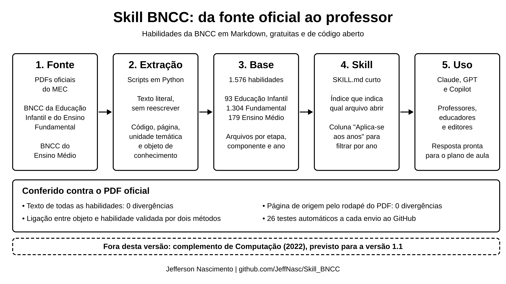

# Skill BNCC

Habilidades da BNCC em Markdown, conferidas contra os PDFs oficiais do MEC, para usar com Claude, GPT e Copilot. Gratuita e de código aberto.



## Por que eu construí isto

Trabalho com conteúdo didático e vejo todo dia o mesmo problema: quando alguém pede a uma IA uma habilidade da BNCC, ela responde com segurança, mas o código nem sempre existe e o texto nem sempre é o oficial. Em planejamento de aula, em material didático e em submissão editorial, isso é um erro caro.

Decidi não depender da memória do modelo. Em vez de perguntar à IA o que ela lembra, entreguei a ela a base oficial, em um formato que ela consegue consultar sem inventar. Esta skill é o resultado: 1.576 habilidades, com o texto literal, o código, a página do PDF e a organização curricular de cada uma.

## O que há na base

| Etapa | Habilidades |
| --- | --- |
| Educação Infantil (objetivos de aprendizagem e desenvolvimento) | 93 |
| Ensino Fundamental | 1.304 (574 nos anos iniciais e 730 nos anos finais) |
| Ensino Médio | 179 |
| **Total** | **1.576** |

Cada habilidade ocupa uma linha, com o texto literal, o código oficial e a página do PDF de origem. No Ensino Fundamental, a linha traz também a unidade temática (ou prática de linguagem), o objeto de conhecimento e, quando existem, o campo de atuação ou o eixo. Uma coluna "Aplica-se aos anos" lista os anos de cada habilidade (por exemplo, "1, 2"), e os arquivos de Língua Portuguesa são divididos por bloco de anos.

## Decisões que tomei

Registrei o raciocínio completo em [docs/decisoes.md](docs/decisoes.md). As principais:

- **Contar no PDF oficial, não em sites.** Vários sites citam 183 habilidades no Ensino Médio. O documento oficial do Ensino Médio traz 179. A base segue o documento.
- **Texto literal, sem reescrever.** Uma skill que paráfrase a BNCC deixa de servir como referência. Quando a IA resume, ela precisa avisar.
- **Arquivos pequenos e um índice.** A IA abre só o arquivo da etapa, do componente e do ano pedidos. Isso poupa contexto e reduz confusão entre componentes.
- **Coluna "Aplica-se aos anos".** Descobri nos testes que filtrar o 2º ano pelo texto da coluna Ano perdia mais da metade das habilidades de Língua Portuguesa, porque as habilidades de bloco (EF12, EF15) valem para vários anos. No 2º ano, são 67 habilidades de verdade contra 29 pela busca literal.
- **Não afirmar ligação que a BNCC não faz.** Em várias tabelas, um conjunto de habilidades divide uma célula com vários objetos de conhecimento. A base reproduz o agrupamento e não inventa uma correspondência um a um.
- **Computação (2022) fora desta versão.** Não consegui o anexo oficial e preferi não usar fontes secundárias. Está avisado na skill, aqui e no post de lançamento.

## Pensada para quem não é de tecnologia

Professores, educadores e editores são o público. A skill conversa em português simples, não pede códigos, faz uma pergunta curta por vez e devolve o resultado pronto para copiar no plano de aula, com a página do PDF oficial para conferir.

Exemplos de pedidos:

- "Preciso de uma aula de frações para o 6º ano."
- "Quais habilidades posso trabalhar com crianças de 4 anos em fala e escuta?"
- "Quero conferir se a habilidade EF07CI01 combina com minha atividade sobre máquinas simples."
- "Monte uma lista de habilidades de Geografia do 8º ano para o bimestre."
- "Que habilidades de Língua Portuguesa do Ensino Médio tratam de argumentação?"

## Estrutura

```
skill-bncc/
  SKILL.md                      instruções da skill (curtas)
  references/
    indice.md                   mapa dos arquivos e guia dos códigos
    educacao-infantil.md
    ensino-fundamental/
      anos-iniciais/            um arquivo por componente (Língua Portuguesa em 3 partes por bloco de anos)
      anos-finais/              um arquivo por componente (Língua Portuguesa em 3 partes por bloco de anos)
    ensino-medio/               um arquivo por área, com o texto das competências específicas no topo
  scripts/
    extrair_bncc.py             gera references/ a partir dos PDFs oficiais
    extrair_objetos.py          liga cada habilidade a unidade e objeto, pela geometria das tabelas
    extrair_competencias_em.py  extrai o texto das competências específicas do Ensino Médio
    validar_bncc.py             confere contagens, formato, numeração e páginas
    verificar_ligacao.py        verifica por dois caminhos independentes a ligação entre objeto e habilidade
    verificar_fidelidade_pdf.py confere texto e página de cada habilidade contra os PDFs oficiais
    empacotar_gpt.py            junta os arquivos em 16 para GPT e Copilot
  tests/regressao.py            testes automáticos dos fatos que a skill precisa respeitar
  adapters/
    gpt/instrucoes.md
    copilot/instrucoes.md
  docs/                         decisões do projeto e diagrama
```

## Como usar

**Claude:** envie a pasta como skill (com o `SKILL.md` na raiz) em Configurações, Capacidades, Skills, e peça, por exemplo: "Quais habilidades de Matemática do 7º ano tratam de proporcionalidade?"

**GPT personalizado:** siga `adapters/gpt/instrucoes.md`. O script `empacotar_gpt.py` gera 16 arquivos, dentro do limite de 20 do conhecimento de um GPT.

**Microsoft Copilot:** siga `adapters/copilot/instrucoes.md`.

Quer testar e me ajudar a melhorar? Veja [COMO-TESTAR.md](COMO-TESTAR.md), o [MANUAL-DE-TESTE.md](MANUAL-DE-TESTE.md) e o [PROMPT-DE-TESTE-COMPLETO.md](PROMPT-DE-TESTE-COMPLETO.md), que funciona em qualquer IA sem configuração prévia.

## Como a base foi validada

1. Os textos vêm dos PDFs oficiais do MEC (EI e EF, versão homologada em 2017; Ensino Médio, documento de 2018). Nada foi digitado.
2. A extração usa `pdftotext` e lê a posição das tabelas com `pdfplumber`. Quando o PDF está danificado, o `qpdf` o repara antes.
3. A contagem oficial foi feita nos códigos únicos entre parênteses dos PDFs e é a referência do validador.
4. O texto de todas as habilidades e a página de cada uma (pelo número impresso no rodapé do PDF) foram conferidos contra os PDFs: 0 divergências em 1.576.
5. A ligação entre objeto de conhecimento e habilidade foi validada por dois algoritmos independentes e por inspeção visual de páginas de seis componentes.
6. Os testes de `tests/regressao.py` rodam a cada envio ao GitHub.

Os testes automáticos e as conferências acharam erros meus, que corrigi: um hífen perdido em "gráfico-visuais", faixas de página do Ensino Médio, subitens de objeto com marcador duplicado e um filtro por ano que perdia habilidades. Está tudo no [CHANGELOG.md](CHANGELOG.md).

Para conferir por conta própria:

```
python3 -I tests/regressao.py
python3 -I scripts/verificar_fidelidade_pdf.py references <pdf_ei_ef_reparado> <pdf_ensino_medio>
python3 -I scripts/validar_bncc.py
```

Para regenerar a base a partir dos PDFs:

```
python3 scripts/extrair_bncc.py --ei-ef BNCC_EI_EF_110518_versaofinal_site.pdf --em BNCC_EnsinoMedio_embaixa_site_110518.pdf --saida references
python3 scripts/validar_bncc.py references
```

Requisitos: Python 3, `pdfplumber`, `pypdf`, `pdftotext` (poppler-utils) e, se o PDF estiver danificado, `qpdf`.

## Limites desta versão

- **Computação (2022) não está incluída.** O complemento (Parecer CNE/CEB 2/2022 e Resolução CNE/CEB 1/2022) entra na versão 1.1, como módulo separado, depois de conferido linha a linha no anexo oficial.
- Não inclui as competências gerais, as competências específicas do Ensino Fundamental nem os textos introdutórios.
- O PDF de EI e EF traz, nas páginas finais, uma versão anterior do Ensino Médio (183 códigos). A base usa o PDF específico do Ensino Médio (179).
- Quando uma célula de objetos reúne vários itens, eles valem para o conjunto de habilidades da célula (por exemplo, em Ciências do 7º ano, quatro objetos para EF07CI01 a EF07CI06).
- Em EF67LP27, o PDF oficial não traz ponto final. O texto foi mantido literal.
- A BNCC pode ser atualizada pelo MEC. Para uso normativo, confira sempre o documento oficial.

## Como foi feito

Eu defini o problema, a fonte, o escopo, os critérios de validação e o público, e tomei as decisões acima. Usei o Claude como assistente para escrever e revisar os scripts, rodar as baterias de teste e redigir a documentação, e conferi os resultados contra os PDFs oficiais.

## Licença

Código, organização e documentação sob licença MIT. O texto da BNCC é de titularidade do Ministério da Educação e está reproduzido sem alterações. Veja `LICENSE`.

## Autor

**Jefferson Nascimento** | [github.com/JeffNasc](https://github.com/JeffNasc)

Sugestões e correções são bem-vindas em Issues.
